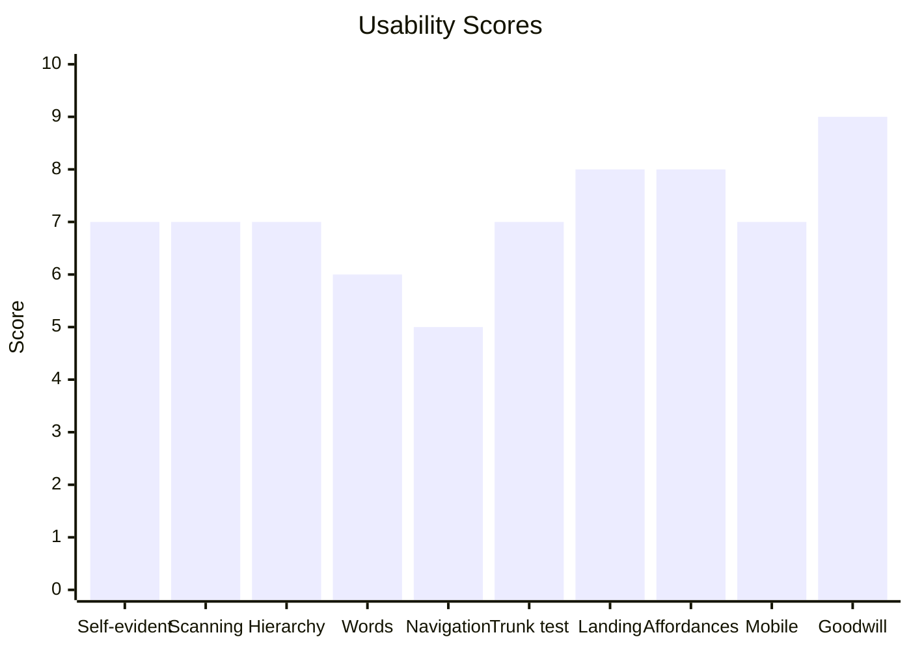
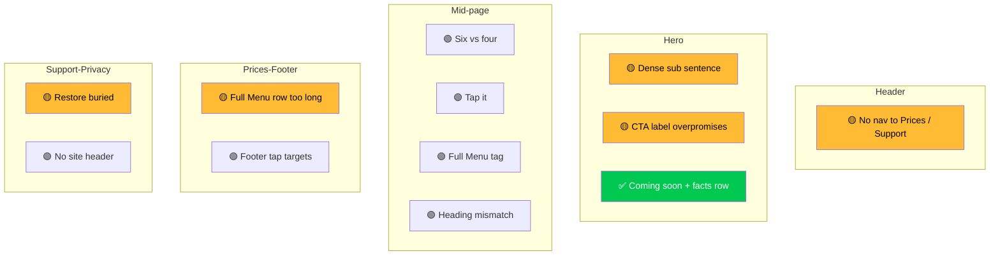
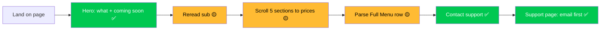

# Usability Review: Tapioca Junction landing site (index, support, privacy, 404)

> Orchestrated by: design-optimizer

**Result:** COMPLETE — 11 issues (0 🔴 · 5 🟡 · 6 🟢); 10 of 10 applicable lenses scored

## Thinking Cost: MODERATE

> The two things the page exists for, prices and support, sit at the bottom of a long scroll (desktop around 2,800 px of 4,407; mobile around 5,500 px of 7,092, visual estimate) with no header links to reach them.

## Scorecard

| Lens | Score | Why |
|---|---|---|
| Self-evidence | 7/10 | Eyebrow "Coming soon to iPhone" + "logic puzzle" are clear; hero `.sub` mechanic sentence needs a reread |
| Scanning | 7/10 | Clear h2 per section and cards; support page `How to play` / `Purchases` are paragraph walls |
| Hierarchy | 7/10 | One gradient CTA per screen, strong h1; Full Menu price row's long text outweighs its price |
| Words | 6/10 | Unlock rules inside the price row, "Six pearls … left, right, left, right" miscount, ambiguous "Tap it" |
| Navigation | 5/10 | No header nav; prices and support reachable only by scrolling or via the footer |
| Trunk test | 7/10 | Index passes; support/privacy have no logo and switch to a light system-ui theme, identity is only a "← Tapioca Junction" text link |
| Landing | 8/10 | In 5 s: calm bubble-tea logic puzzle, iPhone, coming soon, no ads, 40 orders free |
| Affordances | 8/10 | Gradient buttons and underlined links are obvious; hero CTA promises a visual "see" but lands on text steps |
| Mobile | 7/10 | No horizontal overflow at 390 (manifest); single-column cards read well; footer links about 24 px tall |
| Goodwill | 9/10 | Prices shown before launch, Tip Cup "unlocks nothing", no dark patterns, honest "coming soon" with no store link |

## Issues

### 🟡 Prices and support are buried, no header navigation
- **Problem:** A visitor who came to check price or ask a question must scroll past 5 sections; header shows only icon + name.
- **Impact:** The page's two goals (prices, support) are the hardest things to find.
- **Fix:** Add a small right-aligned nav in `header.top`: `How it plays` (#how) · `Prices` (#price) · `Support` (support.html), DM Mono 14 px, `--ink2`; give the price section `id="price"`.
- **Where:** `index.html` `header.top`; `section[aria-labelledby="price-h"]`

### 🟡 Hero sub sentence is hard to parse
- **Problem:** "Every pearl flips the flipper it passes, so each jar runs down the route you set before you poured, pearl by pearl." mixes tenses and stacks clauses.
- **Impact:** First-time visitors reread the one sentence meant to explain the game.
- **Fix:** "A calm logic puzzle at a bubble-tea counter after dark. Point the flippers, pour a jar, and watch every pearl find its cup."
- **Where:** `index.html` `.hero .sub`

### 🟡 Full Menu price row mixes price with unlock rules
- **Problem:** At 390 px the row is ~5 lines of text with `$3.49` stacked below it; unlock order details sit in the price list.
- **Impact:** Price comparison across rows takes effort; the price is visually lost.
- **Fix:** Shorten to "Full Menu: Cheese Foam and Late Night, 40 more orders. One-time purchase, restorable." and move "Cheese Foam order 1 opens at once; Late Night opens when you finish Cheese Foam." to the FAQ or support page.
- **Where:** `index.html` `.prices li:nth-child(2) span`

### 🟡 Hero CTA promises a visual it does not deliver
- **Problem:** "See how a jar plays out" jumps to `#how`, three text cards, no animation or image.
- **Impact:** Mild expectation mismatch on the only hero action.
- **Fix:** Relabel to "See how it plays".
- **Where:** `index.html` `.hero a.btn`

### 🟡 Support page: restore steps buried in paragraphs
- **Problem:** `How to play` and `Purchases` are 9-10 line paragraphs; "Settings → Restore purchases" is the last sentence.
- **Impact:** The most common support answer is hard to scan for.
- **Fix:** Split `Purchases` into bullets and add an h2 "Restore a purchase" with "Open Settings → Restore purchases (same Apple ID)."; turn `How to play` into a 4-step `<ol>`.
- **Where:** `support.html` `main h2` "How to play", "Purchases"

### 🟢 "Six pearls" vs four directions
- **Problem:** "Six pearls down one junction go left, right, left, right." lists four.
- **Impact:** Careful readers stop to count.
- **Fix:** "Pearls down one junction go left, right, left, right, and so on."
- **Where:** `index.html` `#track + .lead`

### 🟢 Ambiguous "Tap it"
- **Problem:** "Tap it to send them again" — "it" could be the pearl or the cup.
- **Impact:** Brief pause.
- **Fix:** "Tap the return jar to send them again, oldest first."
- **Where:** `index.html` card "Misses come back"

### 🟢 "Full Menu" tag undefined until the price list
- **Problem:** Menus III/IV are tagged `Full Menu` before the page says it is a purchase.
- **Impact:** Visitors guess whether those menus cost money.
- **Fix:** Tag text "Full Menu · $3.49".
- **Where:** `index.html` `.menu .tag` (III, IV)

### 🟢 Section heading does not match its cards
- **Problem:** "Made to be read at a glance" covers stamps but also helps and "Quiet by design".
- **Impact:** Heading cannot be trusted when scanning.
- **Fix:** Rename h2 to "Made for calm play".
- **Where:** `index.html` `#see-h`

### 🟢 Support/privacy lose site identity
- **Problem:** No icon or Night Signal header; in light mode the pages turn cream with system font.
- **Impact:** Visitors may briefly wonder if they left the site (brand detail is ux-ax-review's lens).
- **Fix:** Reuse the index `header.top` (40 px icon + "Tapioca Junction", linked to `./`) at the top of both pages.
- **Where:** `support.html`, `privacy.html` first `
` in `main`

### 🟢 Small footer tap targets
- **Problem:** Footer links are 15 px text, about 24 px tall (visual estimate).
- **Impact:** Mis-taps on phone.
- **Fix:** `footer nav a { padding: 10px 0; display: inline-block; }`
- **Where:** `index.html` `footer nav a`

## Issue Map

## Page Flow Analysis

## What Works

- ✅ "Coming soon to iPhone" eyebrow, FAQ "When can I play?", no store badge or link
- ✅ Facts row (No ads · No timers or lives · Plays offline · 40 orders free) answers objections in one glance
- ✅ Real gameplay screenshot beside the hero at both widths
- ✅ Prices listed openly, Tip Cup honestly says it unlocks nothing
- ✅ Support page leads with the email and what to include
- ✅ 404 offers home, support and privacy routes
- ✅ Night Signal style (syrup-brown, milk-white, taro-to-strawberry gradient, Sora + DM Mono) stays untouched by every fix above

## Fix Priority

| Priority | Issue | Effort | Impact |
|---|---|---|---|
| 1 | Header nav to Prices / Support | Low | High |
| 2 | Hero sub rewrite | Low | Medium |
| 3 | Full Menu row shortened | Low | Medium |
| 4 | Hero CTA relabel | Low | Medium |
| 5 | Support restore section + bullets | Low | Medium |
| 6 | "Six pearls" copy | Low | Low |
| 7 | "Tap it" copy | Low | Low |
| 8 | Full Menu tag with price | Low | Low |
| 9 | Heading rename | Low | Low |
| 10 | Footer tap targets | Low | Low |
| 11 | Site header on support/privacy | Medium | Low |

## Evidence and Limits

- **Reviewed:** evidence-dir `manifest.json`, `page.html`, `screenshots/index-390.png`, `index-390-full.png`, `index-1280.png`, `index-1280-full.png`, `support-390-full.png`, `privacy-390-full.png`, `404-390.png`; source `index.html`, `support.html`, `privacy.html`, `404.html`
- **Measured:** none — visual inspection only (`process_screenshots.py` not run); "no horizontal overflow at 390" is from the manifest
- **Not assessed:** none
- **Not tested:** hero CTA click, footer and FAQ link clicks, mailto, hover states, resize between 390 and 1280, dark-mode rendering of support/privacy
- **Assumptions:** Assumption: the broken icon and links on `404-390.png` come from the absolute `/tapioca-junction-site/` paths on the local server and resolve on GitHub Pages. Assumption: scroll positions above are scaled visual estimates.

## Next Decision

Choose whether design-optimizer's apply step takes fixes 1-5 (copy and header nav only, style unchanged); each fix gets a dry-run diff before any write.
